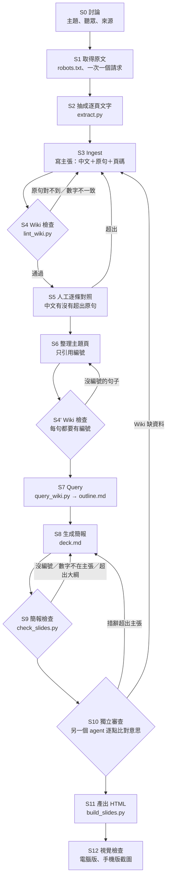

# 貓糧 LLM Wiki × 教學簡報

主題：**看懂貓糧：怎麼選、怎麼餵**。先把 9 份獸醫指引、產業指引和政府資料 ingest 成 LLM Wiki，再只用這個 Wiki 當知識來源，產生一份給「沒養過貓的人」看的 HTML 教學簡報。

- **簡報**：https://chen-mouchin.github.io/cat-food-wiki/
- **Wiki 首頁**：[wiki/index.md](wiki/index.md)；紀錄：[wiki/log.md](wiki/log.md)
- **規則**：[AGENTS.md](AGENTS.md)（[CLAUDE.md](CLAUDE.md) 匯入同一份）

## 核心設計：每一句都追得到原文

```
簡報的一點  ──引用──▶  Wiki 主張 [C-DM-02]  ──原句＋頁碼──▶  原文 PDF 第 N 頁
```

- Wiki 的每條知識都是一條「主張」：編號、中文、英文原句、頁碼（`wiki/sources/*.md`）。
- 主題頁（`wiki/concepts/*.md`）只能引用主張編號，不能新增事實。
- 簡報（`slides/deck.md`）的每一點都要標主張編號，數字必須出現在引用的主張裡。
- 檢查程式會回到原文逐條比對；簡報每頁底部列出依據的主張、來源和頁碼。

## Loop／Graph



**會重複執行的步驟**
- S3 ↔ S4：每份來源 ingest 後都跑 lint；原句對不到或數字不一致，就回去重抄那一條。
- S8 ↔ S9 ↔ S10：簡報每改一次都重跑檢查；審查發現措辭超出主張，退回 S8 重寫那一點。
- S10 → S3：審查發現 Wiki 本身缺資料（例如三份指引的熱量數字為什麼不同），就退回 ingest 補主張，再往下走一遍。

**為什麼這樣設計**
- LLM 最容易出錯的地方是「看起來有根據、其實沒有」：抄錯列、多寫一句推論、把「適當加工」寫成「煮熟」。所以每一層都要求可追溯，能機器檢查的就寫成程式，檢查不了的「意思」交給獨立的審查 agent。
- 簡報只能用大綱列出的主張（S7 先查 Wiki），避免生成時憑印象補內容。

## 怎麼跑

```bash
python scripts/extract.py        # raw/*.pdf → raw/*.txt（raw/ 不進 git，照 data/sources.json 下載）
python scripts/lint_wiki.py      # Wiki 檢查
python scripts/query_wiki.py 乾物 罐頭
python scripts/check_slides.py   # 簡報檢查
python scripts/build_slides.py   # 兩支檢查都通過才產出 docs/index.html
```

需要 Python 3.10 以上；`extract.py` 另需 PyMuPDF，其他只用標準函式庫。

## 執行紀錄

- [runs/RUN_2026-11-19.md](runs/RUN_2026-11-19.md)：第一次完整執行的每一步、每次檢查的結果和修法。
- `runs/lint_*.txt`、`runs/check_*.txt`、`runs/review_*.md`：每次檢查的原始輸出。

## 來源與授權

9 份來源列在 [data/sources.json](data/sources.json)。原文有著作權，repo 只放出處與短句引用，不放 PDF 和全文。線條貓插畫為貓健康站自有素材。開發協作：Claude Code（Anthropic）。內容為衛教資訊，不取代獸醫師的建議。
