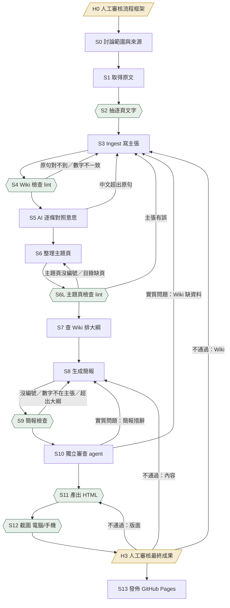

# 貓糧 LLM Wiki × 教學簡報

主題：**看懂貓糧：怎麼選、怎麼餵**。先把 9 份獸醫指引、產業指引和政府資料 ingest 成 LLM Wiki，再只用這個 Wiki 當知識來源，產生一份給「沒養過貓的人」看的 HTML 教學簡報。

- **簡報**：https://chen-mouchin.github.io/cat-food-wiki/
- **Wiki 首頁**：[wiki/index.md](wiki/index.md)；紀錄：[wiki/log.md](wiki/log.md)
- **規則**：[AGENTS.md](AGENTS.md)（[CLAUDE.md](CLAUDE.md) 匯入同一份）

## 核心設計：每一句都追得到原文

```
簡報的一點  ──引用──▶  Wiki 主張 [C-DM-02]  ──原句＋頁碼──▶  原文 PDF 第 N 頁
```

- Wiki 的每條知識都是一條「主張」：編號、中文、英文原句、頁碼（`wiki/sources/*.md`）。
- 主題頁（`wiki/concepts/*.md`）只能引用主張編號，不能新增事實。
- 簡報（`slides/deck.md`）的每一點都要標主張編號，數字必須出現在引用的主張裡。
- 檢查程式會回到原文逐條比對；簡報每頁底部列出依據的主張、來源和頁碼。

## Loop／Graph

`scripts/run_graph.py` 照圖走，程式節點自動跑；遇到 AI 節點或人工關卡就停下來等；檢查不通過時，照圖上的線退回。下面的圖由同一支程式產生（`python scripts/run_graph.py --mermaid`）。

### （現在的 graph）

圖例：
- 綠色六角形：程式自動執行。
- 方框：AI agent 執行。
- 黃色平行四邊形：人工關卡。



### 三種節點

| 類型 | 節點 | 怎麼執行 |
|---|---|---|
| 程式（auto） | S2 抽逐頁文字、S4 Wiki 檢查、S6L 主題頁檢查、S9 簡報檢查、S11 產出、S12 截圖 | `run_graph.py` 直接呼叫，結果存進 `runs/graph/` |
| AI agent | S0 討論範圍、S1 取得原文、S3 Ingest、S5 逐條對照意思、S6 主題頁、S7 排大綱、S8 生成簡報、S10 獨立審查、S13 發佈 | 程式停下來，把要修的項目寫進 `runs/tasks/<節點>.md`；agent 做完用 `--done` 標記 |
| 人工（human） | **H0 審核流程框架**、**H3 審核最終成果** | 程式產生 `runs/gates/<關卡>.md`，負責人填「判定：」，程式讀檔後決定往哪走 |

### 人在哪裡把關

負責人只在兩個關鍵的地方把關，中間的檢查交給程式和 AI：

- **H0 審核流程框架**（開始前）：整條流程怎麼走、哪裡要檢查、什麼時候退回、最多退回幾次，都由負責人審核通過才開始。框架錯了，後面每一步都會跟著錯。
- **H3 審核最終成果**（發佈前）：負責人看簡報本身、截圖，以及這次執行經過哪些節點、退回過幾次，再決定能不能發佈。發佈到公開網址是對外的動作，必須由人決定。不通過時依原因退回：內容 → S8、Wiki → S3、版面 → S11。
- 中間由程式和 AI 分工：程式查得到的（原句、數字、編號、格式）由程式查；意思有沒有超出原文，先由 AI 逐條對照，再交給另一個沒看過寫作過程的 AI 審查。審查意見由程式分流：有「實質」問題就退回，只剩「輕微」才往下走。

### 會重複執行的迴圈與停止條件

| 迴圈 | 什麼時候退回 | 什麼時候結束 |
|---|---|---|
| S3 ↔ S4 | 原句不在原文那一頁、中文的數字不在原句裡 | lint 0 FAIL |
| S3 ↔ S5 | 中文超出原句（AI 逐條對照） | 對照沒有發現超出 |
| S6 ↔ S6L | 主題頁有句子沒有主張編號、Wiki 首頁缺頁 | lint 0 FAIL |
| S6L → S3 | 整理主題頁時發現主張本身有誤 | 回 S3 修好後重走 S4 以下 |
| S8 ↔ S9 | 沒編號、數字不在主張裡、用了大綱沒列的主張、目錄對不到標題 | check_slides 0 FAIL |
| S8 → … → S10 | 審查有實質問題：簡報措辭 | 審查實質問題 0 |
| S10 → S3 | 審查有實質問題：Wiki 缺資料 | 補主張後重走 S4 以下 |
| H3 → S8／S3／S11 | 負責人審核成果不通過 | 負責人判定可以發佈 |

每條回頭的線最多走 **3 次**。超過就不再自動退回，停下來交給人決定下一步（`--goto`），避免 AI 一直改同一個地方。

### 為什麼這樣設計

- LLM 最容易犯的錯是「看起來有根據、其實沒有」：抄錯列、多寫一句推論、把「適當加工」寫成「煮熟」。所以每一層都要求可以追溯。程式查得到的寫成程式；程式查不到的「意思」，先交給 AI 對照和獨立審查，最後由人在關卡把關。
- 簡報只能用大綱列出的主張（S7 先查 Wiki），避免生成時憑印象補內容。
- 人不逐條檢查，只把關兩件事：一開始的流程框架，和最後要公開的成果。逐條比對交給程式，意思交給 AI 對照和獨立審查，人的時間花在 AI 最不能自己決定的地方。

### 怎麼執行這張圖

```bash
python scripts/run_graph.py --reset H0        # 開始一次執行（先過 H0 框架審核）
python scripts/run_graph.py                   # 繼續；停在 agent 節點或人工關卡
python scripts/run_graph.py --done S10 "說明" runs/review_05.md   # agent 做完（S10 附審查檔）
python scripts/run_graph.py --status          # 目前停在哪裡、每條線走了幾次
```

每一步都自動記在 [runs/graph_log.md](runs/graph_log.md)，人工關卡的判定留在 `runs/gates/`。

## 怎麼跑

```bash
python scripts/extract.py        # raw/*.pdf → raw/*.txt（raw/ 不進 git，照 data/sources.json 下載）
python scripts/lint_wiki.py      # Wiki 檢查
python scripts/query_wiki.py 乾物 罐頭
python scripts/check_slides.py   # 簡報檢查
python scripts/build_slides.py   # 兩支檢查都通過才產出 docs/index.html
python scripts/run_graph.py      # 照 graph 執行整條流程（見上一節）
```

需要 Python 3.10 以上；`extract.py` 另需 PyMuPDF，其他只用標準函式庫。

## 執行紀錄

- [runs/RUN_2026-11-19.md](runs/RUN_2026-11-19.md)：第一次完整執行的每一步、每次檢查的結果和修法。
- `runs/lint_*.txt`、`runs/check_*.txt`、`runs/review_*.md`：每次檢查的原始輸出。

## 來源與授權

9 份來源列在 [data/sources.json](data/sources.json)。原文有著作權，repo 只放出處與短句引用，不放 PDF 和全文。線條貓插畫為貓健康站自有素材。開發協作：Claude Code（Anthropic）。內容為衛教資訊。
